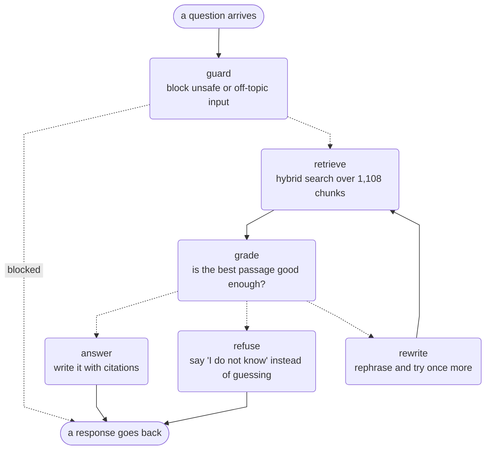

# Medicare RAG Assistant

**Ask a question about Medicare in plain English. Get an answer that is quoted from
the official government booklets, with the page number next to every claim — and an
honest "I don't know" when the booklets don't answer it.**

**Live demo:** <!-- BEGIN:demo-url -->deploying — see *Run it yourself* below<!-- END:demo-url -->
**Source:** https://github.com/Sudam23/medicare-rag-assistant

Built by Sudam Kumar Paul as a portfolio project for an AI/ML engineering role.
Not medical, legal or insurance advice.

---

## 1. The problem, in simple words

Medicare is explained across thousands of pages of official PDFs. A person who wants
to know something simple — *"does Medicare pay for my dentist?"* — has to guess which
booklet to open and then read until they find it. Most people give up and ask a
general chatbot instead, and a general chatbot will answer confidently even when it is
wrong, with nothing to check it against. That is dangerous here, because a wrong
answer about coverage costs somebody real money.

**This project fixes that.** It reads only the nine official CMS booklets, finds the
exact passages that answer your question, and shows you the answer *with the booklet
name and page number beside it*, so you can open the real PDF and verify it yourself.
If the booklets do not contain the answer, it says so instead of inventing one.

---

## 2. What you actually get

You type a question. You get back three things:

1. **An answer** — in this default mode, sentences copied word-for-word from the booklets
2. **The sources** — booklet, page, and a link that opens the real PDF on that page
3. **A confidence signal** — how strong the match was, and why

### A real example, produced by the running system

> **Q: Does Medicare cover dental care?**
>
> Most dental care: In most cases, Original Medicare doesn't cover dental services
> like routine cleanings, fillings, tooth extractions (removals), or items like
> dentures. **[2]** However, in some cases, Original Medicare may pay for some dental
> services closely related to certain covered services like: **[2]** Dental or oral
> exams before or while getting Medicare-covered dialysis services (if you have
> End-Stage Renal Disease (ESRD)). **[4]** For Part B-covered dental services, you pay
> 20% of the Medicare-approved amount after you meet the Part B deductible. **[4]**
>
> **[1]** Your Medicare Benefits, p. 32 · **[2]** Medicare & You, p. 58 ·
> **[3]** Medicare & You, p. 12 · **[4]** Your Medicare Benefits, p. 32

Every `[n]` is a link. Click it and the real government PDF opens at that page.

### And a real refusal

> **Q: What is the best stock to buy?**
>
> I could not find this in the Medicare publications I have, and I would rather tell
> you that than guess. Try rewording the question, or call 1-800-MEDICARE.
>
> *Best retrieved passage scored 0.567, below the 0.62 threshold.*

This is the part most RAG demos skip. **Refusing well is a feature**, and section 6
shows it is measured: 100% of the out-of-scope test questions were refused.

---

## 3. How it works — the whole system

```
  ONE TIME (make data && make index)          EVERY QUESTION (make serve)

  9 official PDFs from medicare.gov            Browser (plain HTML + JS)
            |                                            |
            v                                            v
  [1] Parse pages with pypdf                   FastAPI  /api/ask
      fix the printed page numbers                       |
            |                                            v
            v                                   +------------------+
  [2] Split into ~900-character chunks          |  LangGraph       |
      that stop at paragraph breaks             |  state machine   |
            |                                   |  (diagram below) |
            +---------------+                   +------------------+
            |               |                       |          |
            v               v                       v          v
  [3] Embeddings      [4] BM25 keyword        Qdrant       BM25 index
      bge-small-en        inverted index      (meaning)    (exact words)
      384-dim                  |                   |          |
            |                  |                   +----+-----+
            v                  v                        v
       Qdrant (on disk)   .npz on disk          fused, graded, cited
```

**The decision logic is not drawn by hand.** The diagram below is exported directly
from the compiled LangGraph object by `make docs`, so it cannot drift away from the
code it describes. Dotted arrows are conditional — the pipeline *chooses* that path at
runtime.

<!-- BEGIN:pipeline-diagram -->

<!-- END:pipeline-diagram -->

### What each step does, in plain words

| Step | What it does | Why it exists |
| --- | --- | --- |
| **guard** | Checks the question before anything else | Stops Medicare numbers, SSNs and prompt-injection attempts from ever reaching the model or the logs |
| **retrieve** | Searches the booklets two ways at once and merges the results | Neither search alone is enough — see section 7 |
| **grade** | Asks "is the best passage actually good enough?" | This is the switch between answering and refusing |
| **rewrite** | Rephrases the question and searches once more | A question worded oddly can still have an answer in the booklets |
| **answer** | Writes the answer and attaches a citation to each part | Citations are verified after writing, not assumed |
| **refuse** | Says it does not know | Better than a confident wrong answer about someone's health coverage |

The loop `grade → rewrite → retrieve → grade` is **hard-capped at 2 attempts**. During
development an uncapped version of this graph ran 10,007 steps before LangGraph killed
it; the cap is now enforced in the code and covered by a test
(`test_the_retry_loop_is_capped`).

---

## 4. Two kinds of search, and why both

**Keyword search (BM25)** matches the words you typed. It is what finds *"what is a
guaranteed issue right?"* — a fixed legal term that means nothing by analogy and
everything by its exact wording. On the test split, keyword search finds that one and
*"who does Medicare share my health information with?"* when meaning search misses
both.

**Meaning search (embeddings)** matches what you *meant*. It finds *"does Part B cover
visits to my doctor?"* and *"what is Medicare in simple terms?"*, which keyword search
misses, because the booklets phrase those ideas in words the question never uses.

They are combined with **weighted Reciprocal Rank Fusion**, which merges *ranks*, not
scores. That matters: cosine similarity lives in [-1, 1] and BM25 is unbounded, so
adding the two numbers together would be meaningless. RRF only asks "how near the top
did each search put this passage?", which is comparable across both.

```
score(passage) = Σ   weight_of_search / (k + rank_in_that_search)
```

---

## 5. What the index contains

<!-- BEGIN:index-facts -->
- **9 official Medicare booklets**, 381 pages, split into **1,108 searchable passages**
- Embedding model `BAAI/bge-small-en-v1.5` (384 dimensions), stored in qdrant-embedded
- Keyword index: 3,794 terms, 65,823 postings
- Whole index builds from the PDFs in 62 seconds on a laptop CPU
<!-- END:index-facts -->

396 pages are parsed; 381 of them reach the index. Fifteen are deliberately left out:

- **4 cover pages and a blank form**, all below the 200-character minimum.
- **11 contents listings and back-of-book index pages.** These are the single densest
  keyword pages in the corpus — an index line reads "Assignment 11, 32–48, 51, 53" —
  so they rank well and then get quoted as an answer. Asking *"what is Part A?"* used
  to return the line *"5 Medicare has different parts 5 Medicare Part A (Hospital
  Insurance) 6"*, read straight off a contents page. They are detected by the heading
  CMS prints on them ("Contents", "Table of contents", "Index of topics") rather than
  by a statistical guess: a digit-density heuristic was tried first and rejected
  because it also flagged the Medigap plan chart, the IRMAA income brackets and the
  state SHIP phone numbers, all of which are real answers.

One real problem worth calling out: **364 pages print a page number on the page, and
on 216 of them that number is not the PDF's own page index.** A booklet whose cover
and contents are unnumbered is already several pages out by the time the content
starts. Citing the PDF index would send a reader to the wrong page. So the parser
extracts the printed number and *cites* that, while the *link* uses the PDF index —
the citation reads the way the page is labelled, and the link still lands in the right
place. The dental example in section 2 shows both at once: cited as page 32, linked
with `#page=34`.

---

## 6. Accuracy — measured, not claimed

All tuning was done on a **dev split**. The **test split was scored once**, at the end,
with no tuning afterwards. That is the whole point of the split; reporting a number you
tuned against is reporting your own fitting error.

### Does the retrieval find the right page?

<!-- BEGIN:retrieval-table -->
| Retrieval strategy | recall@1 | recall@3 | recall@5 | recall@10 | MRR@10 | median latency |
| --- | --- | --- | --- | --- | --- | --- |
| Keyword only (BM25) | 37.1% | 60.0% | 68.6% | 94.3% | 0.526 | 0.6 ms |
| Meaning only (embeddings) **&larr; best MRR** | 51.4% | 68.6% | 91.4% | 94.3% | 0.654 | 4.5 ms |
| Hybrid (shipped) | 48.6% | 74.3% | 88.6% | 94.3% | 0.639 | 4.7 ms |

35 held-out questions, scored once. Higher is better everywhere.
<!-- END:retrieval-table -->

### Does the whole pipeline behave?

<!-- BEGIN:pipeline-table -->
| What is measured | Result | Over what |
| --- | --- | --- |
| Answered an in-scope question | **100.0%** | 35 questions the booklets do cover |
| Refused an out-of-scope question | **100.0%** | 9 questions they do not cover |
| Groundedness | **100.0%** | every sentence traced back to a cited page |
| Cited the correct page | **94.3%** | the gold page was among the citations shown |
| Median response time | **210 ms** | end to end, on a laptop CPU |
| 95th percentile | **297 ms** | the slow ones |
<!-- END:pipeline-table -->

**How to read "cited the correct page".** For 94.3% of in-scope questions, the page
that genuinely answers the question was among the citations shown to the reader.

**One number is deliberately low: citation precision (22.9%).** The system shows
several sources, usually 4, and only one of them is the single gold page, so most
citations are counted "imprecise" even when they are relevant neighbouring pages.
Showing fewer sources would raise this number and make the tool *less* useful. It is
reported rather than hidden because the honest reading is "this metric does not suit
this interface", not "the system cites badly".

---

## 7. An honest negative result

On the ICD-10 project I built before this one, hybrid search beat pure semantic search
decisively. **Here it did not**, and the README says so.

<!-- BEGIN:complementarity -->
| Found by | Questions (of 35) |
| --- | --- |
| Both keyword and meaning search | 31 |
| Meaning search only | 2 |
| Keyword search only | 2 |
| Neither | 0 |
<!-- END:complementarity -->

Only 2 questions of 35 are found by keyword search and missed by meaning search. On
the test split hybrid (MRR 0.639) is in fact a hair *below* dense alone (MRR 0.654) —
a difference of one question, which is noise at this sample size.

I kept hybrid at a low keyword weight (0.1) rather than dropping it, and the tuning
data says exactly why. Raising the weight to 0.6 does help the bare-token queries the
keyword arm exists for — `Plan G` goes from *not in the top 10 at all* to rank 7 — but
across the dev split it moves **1 question onto rank 1 and knocks 6 off it**, so dev
recall@1 falls 0.667 → 0.556.

The benefit is concentrated in two or three odd queries it still does not rank first;
the cost is spread thinly across ordinary prose questions, where it is invisible unless
you measure. That is written down in `docs/tuning_report.json` and re-derived in
[EVALUATION.md](docs/EVALUATION.md), not decided by anecdote.

**The lesson:** the technique that wins on one corpus does not automatically win on the
next one. Medical code descriptions are short and keyword-dense; Medicare booklets are
long prose, which is exactly the case embeddings handle well on their own.

---

## 8. Safety

| Guardrail | What it blocks |
| --- | --- |
| Medicare Beneficiary Identifier (MBI) detection | `1EG4-TE5-MK73` and its unseparated forms — refused before retrieval |
| SSN, card number, email detection | Personal data never reaches the index, the model or the trace log |
| Prompt-injection patterns | "ignore your instructions…" style inputs |
| Citation verification | After an answer is written, each citation is re-checked against the retrieved passages |
| Relevance floor | Below 0.62, the system refuses instead of answering |
| Rate limiting | Protects the public demo |

Redaction runs **before** anything is written to a trace, so a leaked identifier cannot
survive in the observability layer.

---

## 9. Two answering modes

| Mode | When | What it does | Can it hallucinate? |
| --- | --- | --- | --- |
| **Extractive** (default) | No API key set | Selects and quotes real sentences from the retrieved pages | **No** — it generates no new text |
| **Generative** | `ANTHROPIC_API_KEY` is set | Claude writes the answer from the retrieved pages, with citations required | Constrained by the retrieved passages and verified afterwards |

Both return the identical response shape, so the frontend does not care which is
running, and `/api/health` reports which one is active. **Every number in section 6 was
measured in extractive mode**, so the demo is honest with no API key and no spend.

---

## 10. Observability

Every request records a trace: each node that ran, how long it took, which passages
came back with what scores, and which guardrails fired.

- `GET /api/traces` — recent requests
- `GET /api/traces/{id}` — the full story of one request
- `POST /api/feedback` — thumbs up/down, keyed by trace id

The web UI has a "show trace" view, so during a demo you can open the machinery and
show what actually happened rather than describing it.

---

## 11. Run it yourself

```bash
make venv     # create the environment and install
make data     # download the 9 official PDFs from medicare.gov
make index    # parse, chunk, embed, build both indexes  (~1 minute, CPU only)
make serve    # http://127.0.0.1:8000
```

Then:

```bash
make test     # the unit and integration suite
make eval     # re-score the held-out split and regenerate the report
make docs     # regenerate the diagram and every number in this README
make e2e      # drive a real Chrome against a running instance
```

No GPU. No vector database server. No API key required.

### Deploying it

`render.yaml` is a Render blueprint, so the whole service is described in the repo.
With a Render account signed in, open:

```
https://render.com/deploy?repo=https://github.com/Sudam23/medicare-rag-assistant
```

Render reads `render.yaml`, builds the `Dockerfile`, and brings the service up on the
free plan with `/api/health` as the health check. Nothing needs configuring by hand,
and no API key is required — the demo runs in extractive mode.

Once it is live, point the browser test at it:

```bash
make e2e ARGS="--base-url https://<your-service>.onrender.com"
```

The free plan sleeps after inactivity, so the first request to a cold instance takes
around 30 seconds. After that the median is ~220 ms.

---

## 12. Layout

```
src/medicare_rag/
  config.py           every tunable number, in one file
  data/parse.py       PDF -> pages, printed page numbers, running headers
  data/chunk.py       pages -> ~900-char chunks with headings
  rag/embed.py        fastembed / ONNX, asymmetric query prefix
  rag/store.py        Qdrant embedded mode
  rag/lexical.py      BM25 on a NumPy inverted index
  rag/retrieve.py     weighted reciprocal rank fusion
  rag/guardrails.py   input checks, redaction, citation verification
  rag/answer.py       extractive and generative answering
  rag/graph.py        the LangGraph state machine
  api/main.py         FastAPI
  evaluation/         gold set, metrics, the scoring run
web/                  the frontend: plain HTML, CSS and JavaScript
scripts/              tuning sweeps, doc generation, the browser test
data/gold/            98 labelled questions (54 dev, 44 test)
```

---

## 13. Testing

- **Unit and integration tests** cover parsing, chunking, BM25, fusion, guardrails,
  the graph's routing (including the retry cap) and every API endpoint
- **An offline stub model** exercises the generative path without an API key
- **A browser end-to-end test** (`scripts/e2e_browser_test.py`) drives real Chrome
  against a running instance with real clicks and real keystrokes, and is run against
  the deployed site after every deploy

---

## 14. Limitations

- The nine booklets are a **snapshot**. Medicare rules change annually; a deployed copy
  gets stale unless `make data && make index` is re-run.
- It answers **general** Medicare questions, not questions about your specific plan,
  which it has no access to.
- The gold set is 98 questions I labelled myself by reading the pages. It is large
  enough to show a difference of ~10 percentage points and too small to show 2.
- Not medical, legal or insurance advice. For your own situation call 1-800-MEDICARE.
