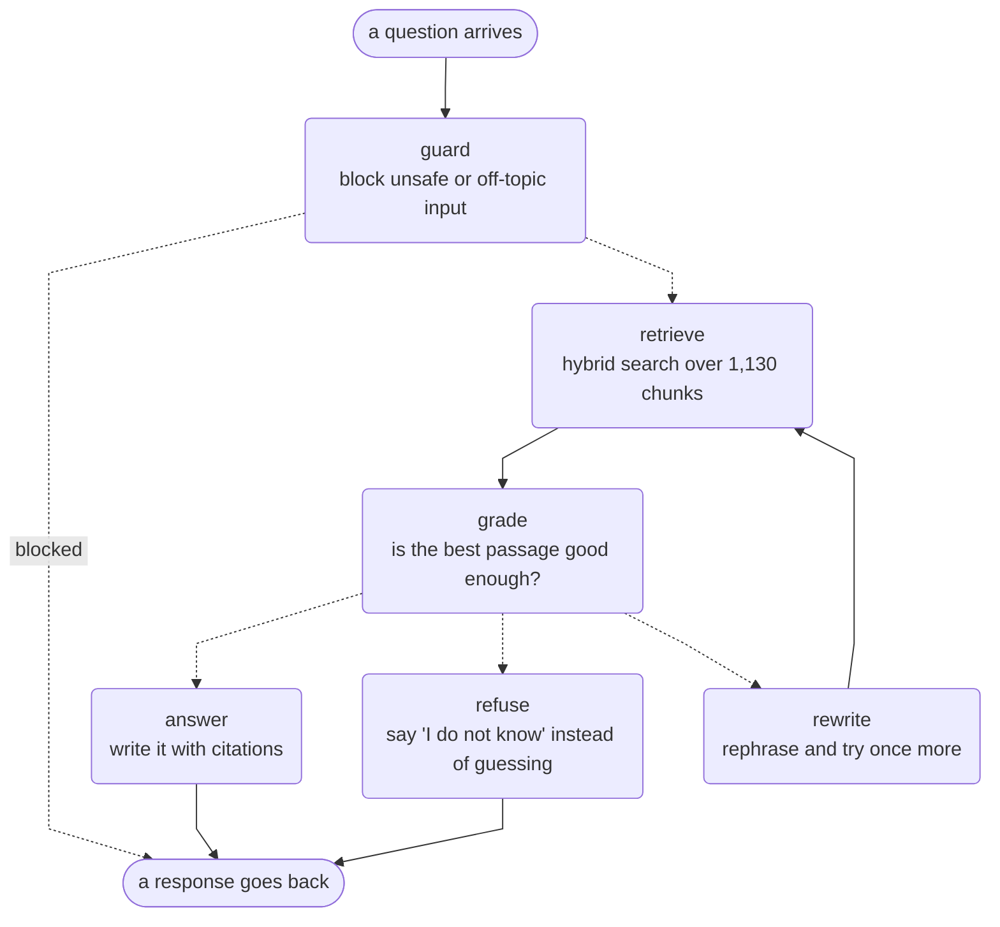

# Architecture

This document explains *why* the system is built the way it is. For what it does and
how to run it, see the [README](../README.md).

## 1. The constraint that shaped everything

The demo has to run on a free hosting tier, on CPU, with **no API key required**, and
still be honest about its accuracy. That single constraint produced most of the
decisions below:

| Decision | Alternative rejected | Why |
| --- | --- | --- |
| Qdrant in **embedded mode** (`QdrantClient(path=…)`) | A hosted vector DB | A real vector database with real payload filters, but no server to run, no account, no cost. The index is a directory in the repo's data folder. |
| **fastembed / ONNX Runtime** | `sentence-transformers` + PyTorch | ONNX runs the same `bge-small-en-v1.5` weights on CPU without a ~2 GB torch install. The container stays small enough for a free tier. |
| **Extractive answering by default** | Requiring an LLM | Selecting real sentences cannot hallucinate. The project is measurable and demonstrable with zero spend; the generative path is additive, not required. |
| **BM25 hand-written on NumPy** | Elasticsearch, or a library | ~120 lines, no service, and the scoring is visible and explainable in an interview — which is the point of a portfolio project. |
| **LangGraph** | A plain function chain | The retry-and-refuse behaviour *is* a state machine. Writing it as one makes the control flow inspectable, traceable, and drawable straight from the compiled object. |

### One consequence worth knowing

Embedded Qdrant takes an **exclusive lock** on its storage directory. Only one
process may hold the index open at a time, which has two practical effects:

- `make test` fails with `Storage folder ... is already accessed by another instance`
  if `make serve` is running. Stop the server first.
- The container runs `uvicorn --workers 1`. This is not a performance oversight; a
  second worker would fail to start. Scaling this design means scaling to a Qdrant
  *server*, which is the trade accepted in exchange for having no service to run.

## 2. The state machine

Generated from the compiled graph by `make docs`:

<!-- BEGIN:pipeline-diagram -->

<!-- END:pipeline-diagram -->

### State

```python
class RagState(TypedDict):
    question: str
    current_query: str  # changes when `rewrite` runs
    k: int
    mode: str  # hybrid | dense | lexical
    doc_ids: list[str] | None  # optional booklet filter
    attempts: int  # guards the loop
    steps: Annotated[list, operator.add]  # appended by every node
    ...
```

`steps` uses `Annotated[list, operator.add]` so each node *appends* its trace entry
rather than replacing the list. Every other key is last-write-wins, which is what you
want for `current_query` and `attempts`.

### Why the loop is capped

`grade → rewrite → retrieve → grade` is a cycle. An early version of this graph, with
a `rewrite` that failed to change anything the grader looked at, ran **10,007 steps**
before LangGraph's recursion limit stopped it. A recursion limit is a crash, not a
behaviour.

So the cap is explicit and is part of the contract:

```python
@staticmethod
def _route_after_grade(state: RagState) -> str:
    if state.get("grade") == "good":
        return "answer"
    if state.get("attempts", 0) >= MAX_RETRIEVAL_ATTEMPTS:
        return "refuse"  # the hard cap that stops the loop
    return "rewrite"
```

A user's worst case is therefore two retrievals and then a refusal — bounded latency,
bounded cost, and a defined answer. `test_the_retry_loop_is_capped` fails if this
regresses.

## 3. Ingestion

### Pages

`pypdf` gives text per page. Two things have to be recovered that the raw text does not
carry cleanly:

**Printed page numbers.** See the README section 5 — 216 of 364 numbered pages print a
number that differs from the PDF index. Citations use the printed number; links use the
PDF index.

**Running headers.** Every page of *Medicare Hospice Benefits* starts with
`Welcome: Medicare Hospice Benefits`. Left in, it is indexed 40 times and pollutes
retrieval. Removing it took three attempts, and the order of operations is the whole
problem:

1. *Strip before parsing* — destroys section metadata, because in `10116` the running
   header **is** the section marker (`Section 2: Items & Services`).
2. *Strip after line-joining* — impossible; `_join_wrapped_lines` has already merged
   the header into the sentence beneath it, and no later pass can separate them.
3. *Strip inside `parse_page`, at line level, after the section is read* — correct.

Result: 0 header leaks, and 114 of 118 section labels preserved. The docstring in
`parse.py` records why, so the ordering is not "cleaned up" by a future reader.

A header is detected as a short line (≤70 chars) appearing in the first 3 lines of at
least 30% of a document's pages, with a minimum of 4 pages.

### Chunks

Target 900 characters, 150 overlap, 200 minimum, split at paragraph boundaries where
possible. Each chunk carries its heading, and the heading is prepended to the embedded
text so that a chunk reading "You pay 20% of the Medicare-approved amount" still
embeds near the topic it belongs to.

Generic headings (`costs`, `note`, `more information`, `what it is`, …) are **not**
prepended — they add noise rather than context.

## 4. Retrieval

### Asymmetric embedding

`bge-small-en-v1.5` is trained asymmetrically. Queries get the prefix

```
Represent this sentence for searching relevant passages:
```

and passages get none. Applying the prefix to both sides, or neither, measurably
degrades retrieval; this is a property of the model, not a style choice.

### Fusion

Weighted Reciprocal Rank Fusion (Cormack et al., 2009):

```
score(d) = Σ_s  w_s / (k + rank_s(d))        k = 20, w_dense = 1.0, w_lexical = 0.1
```

Ranks are fused rather than scores because cosine similarity is bounded in [-1, 1]
while BM25 is unbounded — the two are not on a common scale and adding them is
meaningless. A rank is comparable across any pair of retrievers.

`k = 20` flattens the curve so that a passage ranked 3rd by both searches can outrank
a passage ranked 1st by only one.

The weight of 0.1 is not an arbitrary small number; it is the outcome of a sweep on the
dev split, recorded in `tuning_report.json`. See [EVALUATION.md](EVALUATION.md) for
the trade-off it represents.

## 5. Answering

### Extractive (default)

Score every sentence-or-bullet unit from the retrieved passages against the question,
then take the best few under a character budget. The scoring applies three corrections
that were each added in response to an observed failure:

| Correction | The failure it fixes |
| --- | --- |
| `split_units` splits on line breaks *before* sentences | Bullet lists have no full stops, so sentence splitting glued whole pages together — answers were over 2,000 characters |
| `QUESTION_PENALTY = 0.15` | The best lexical match for a question is often the identical question used as a *heading*; the system quoted the question back |
| Jaccard overlap ≥ 0.6 rejects near-duplicates | A prefix fingerprint missed that "Medicare-approved amount" and "Medicare-certified amount" are the same sentence from two booklets |

Answers now land in the 430–700 character range.

### Generative (when `ANTHROPIC_API_KEY` is set)

Claude is given only the retrieved passages and must cite `[n]` markers. After
generation, `check_citations` verifies every marker against the passages that were
actually retrieved; an answer citing a source that was not retrieved is rejected.

`StubLLM` exercises this entire path in tests with no API key and no network.

## 6. Guardrails

Order matters. `guard` is the **first** node, before retrieval and before any logging,
so a Medicare number in a question never reaches the index, the model, or the trace
store. Redaction runs before the trace is written, not after.

## 7. Observability

Each request builds a `Trace`: node-by-node steps, per-node latency, retrieved
passages with scores, guardrail outcomes, and token counts when the generative path
runs. Traces live in a **bounded ring buffer** — an unbounded list is a memory leak on
a long-running free-tier instance.

`/api/feedback` records thumbs up/down against a `trace_id`, which is what makes the
feedback useful: it points at the exact retrieval that produced the answer.

## 8. What I would do next

1. **A cross-encoder reranker** over the top 40 candidates. Recall@10 is 94.3% while
   recall@1 is 48.6% — a 45-point gap that is a *ranking* problem, which is exactly
   what a reranker fixes.
2. **Multi-hop questions.** "I'm 67, still working, should I take Part B?" needs two
   passages combined. The current pipeline retrieves well but answers from passages
   independently.
3. **A larger gold set.** 98 questions cannot resolve a 2-point difference, which is
   precisely why the hybrid-vs-dense result in this project is reported as a tie
   rather than a win.
